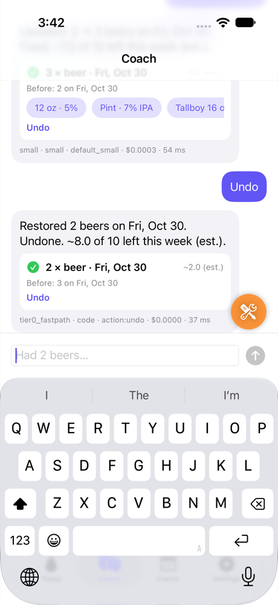
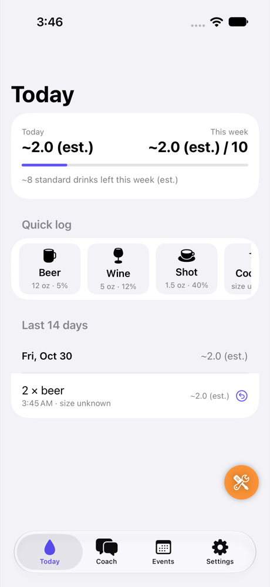
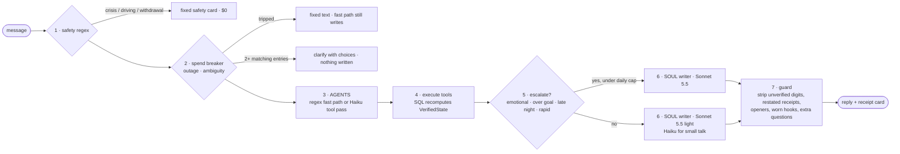

<h1 align="center">SoberCoach</h1>

<p align="center">
  An AI drinking-moderation coach built to be trusted in production:<br>
  <strong>it never gets a number wrong, its safety never depends on a model, and a heavy user costs under $4.50 a month.</strong>
</p>

<p align="center">
  
  
  
  
  
  
  
</p>

<p align="center">
  
  &nbsp;&nbsp;&nbsp;
  
</p>

<p align="center"><em>Code keeps the books. The model only talks.</em></p>

---

## The idea in one paragraph

Every message goes through a **deterministic harness** written in plain TypeScript. Code decides whether a message is a crisis, whether the budget is spent, whether a correction is ambiguous. A small model (Claude Haiku 5.5) is allowed to do exactly one thing: pick **tools** from a fixed registry. Code executes them, recomputes the user's state from SQL, and only then lets a writer model (Claude Sonnet 5.5) put words around a receipt it cannot change. A guard strips any digit the writer did not get from the database. The model never holds the ledger, never decides a safety reply, and never spends past a cap it cannot see.

## What the coach does

| You say | What happens | Who pays |
|---|---|---|
| `2 beers` | Regex fast path writes the entry; the card is the receipt; the writer adds one line | ~$0.003 |
| `actually it was 3` | Correction by entry id, card shows *Before: 2* and *Restored 2 beers* on undo | ~$0.003 |
| `those were last night` | Entry moves days; a day with no rows is **NO DATA**, never zero | ~$0.003 |
| `change that one` with two candidates | Code asks *which one?* with tappable choices. Nothing is written | $0 |
| a blackout night, typed at 1 a.m. | `late_night` / `over_goal` / `rapid_pacing` rules route to the strong writer (capped at 10 a day, and never past the $0.15 daily user budget) | ~$0.005 |
| `I'm trying to cut down for my daughter` | Stated reasons and intentions are stored verbatim in `coach_memory`; the writer never offers to remember | ~$0.003 |
| `what did I say about Dan's?` | `search_history` tool: code searches the user's own earlier messages and prints dated hits with that day's logged total; the writer adds one line. No vector store (`docs/MEMORY_FIELD.md`) | ~$0.01 |
| `party at Dan's on Saturday` / `remind me Friday to call mom` | Standing intents with deterministic defaults; pushes go through nine logged gates | ~$0.003 |
| `stop reminding me` | One consent flip per category, done in code | $0 |
| driving, withdrawal, crisis keywords | Fixed safety card from `safety.ts`. No model call | $0 |
| model provider is down | Logging, undo, buttons and safety all keep working; chat returns fixed text | $0 |
| 我今天喝了兩杯啤酒 | Same pipeline, Chinese receipt lines and writer | ~$0.003 |

Every five typed turns a background **dreaming pass** (Haiku) rewrites a short profile of the person, which the writer reads on the next turn. Settings shows the user exactly what the coach has pieced together, and *Forget* clears it.

## How a message travels: seven gates



| Gate | File | What it owns |
|---|---|---|
| 1 Safety | `supabase/functions/_shared/safety.ts` | Regex over crisis, withdrawal and driving phrases. Fixed card, no model |
| 2 Pre-flight | `_shared/tier0.ts`, `chat/index.ts` | Global daily spend breaker, simulated outage, ambiguous-correction clarify |
| 3 AGENTS | `_shared/prompt.ts`, `_shared/tier0.ts` | Regex fast path for `2 beers` / `undo`; otherwise Haiku returns tool calls and an intent, **no reply text** |
| 4 Execute | `_shared/tools_exec.ts`, `chat/index.ts` | 16 tools from one registry; `verifiedStateFor()` recomputes totals, remaining, pacing, next event |
| 5 Escalate | `_shared/soul.ts` | `shouldEscalateToSonnet()` and `writerPlan()`: written rules, counted against a 10-a-day cap and a $0.15-a-day user budget in the ledger |
| 6 SOUL | `_shared/soul.ts` | Plain-text writer fed the soul profile, verbatim memory, verified ledger state and the execution receipt |
| 7 Guard | `_shared/soul.ts`, `_shared/voice.ts` | `postProcessSoulReply()`: drops sentences with digits not in the verified set, restated receipts, meta self-talk; one question max, zero on routine writes; language check; falls back to a code line |

The proactive side (`supabase/functions/evaluate-triggers`, pg_cron every 15 minutes) never sends a push without a `reminder_log` row carrying a `why_now`, an idempotency key and the trace of nine gates: `CONSENT`, `APNS_TOKEN`, `QUIET_HOURS`, `DAILY_CAP`, `WEEKLY_CAP`, `EVENT_EXISTS`, `STALE`, `COOLDOWN`, `OPENED_TODAY`.

## What it costs

| | |
|---|---|
| Average turn (measured on the hosted ledger) | ~$0.0025 |
| Cold-cache Sonnet turn | $0.005 to $0.007 |
| 35-turn coaching conversation | $0.063 |
| Heavy month (3,000 messages, strong cap hit daily) | ≈ $3.10 modelled, $4.50 ceiling |
| Global breaker | `GLOBAL_DAILY_SPEND_USD`, tripped and restored live |
| Per-user daily budget | `USER_MODEL_BUDGET_USD_PER_DAY` = $0.15 (30 days = the $4.50 ceiling); over it, words come from Haiku and nothing escalates; tripped and restored live |

Every model call is a row in `messages` with model, route reason, tokens in / cached / out, cost and latency. `docs/COST_MODEL.md` derives the ceiling from live list prices.

## What was verified

| Layer | Evidence |
|---|---|
| Pure logic | 85 Deno tests in `supabase/functions/_shared`; `deno check` gates every deploy |
| Schema | `supabase/tests/schema_test.sql`: rollover, NO_DATA, undo, RLS isolation on all 7 tables, cascade delete, reminder claim |
| Acceptance on the deployed stack | `eval/run.ts` 41/41 on all 12 scenarios (208/220 on a double run; misses are the strong cap doing its job); `eval/features.ts` 59/59 (incl. the guideline layer and search_history); `eval/core_probes.ts` 9/9 |
| Mock gateway | 330/330 checks with `OPENROUTER_API_KEY=mock`, so the whole harness runs at $0 |
| iOS | 4 unit tests and the XCUITest journey (sign in → `2 beers` → `actually it was 3` → undo → Today) on the iPhone 17 simulator against the hosted backend |
| Voice | Strict rubric 4.06 / 5 on the deployed build (coaching turns 4.23). Blind pairwise against a real Grok Bot transcript: 24% win-or-tie under a generic judge, 55% once the judge knows the product's rules. Rejudging the same transcript moves up to 17 points, so these are ranges |
| User-style verification | `/verify-sobercoach`, a Claude Code skill in `.claude/skills/`, boots a simulator, runs a 9-check doctor, drives every behaviour over the API and the UI, and leaves evidence under `.verify/` |

Full record: `docs/VERIFICATION.md`. Claim-to-code-to-evidence matrix: `docs/CORE_AUDIT.md`.

## Clinical basis

The coaching rules are tied to published US sources and implemented as code: NIAAA standard drink and low-risk, binge and heavy-day lines (sex-specific, conservative when unknown); AUDIT-C screening at onboarding per the USPSTF 2018 recommendation; motivational-interviewing rules from SAMHSA TIP 35 in the writer prompt (reflect, affirm effort, ask before advising); Marlatt's lapse-is-not-relapse and a stated coping plan quoted in the pre-event nudge. Crossed lines route the turn to the strong writer and may be named once, never as a lecture. Mapping of each rule to code and test: `docs/CLINICAL_BASIS.md`.

## What is not proven

No human has rated the coaching copy; every voice score is a model judging a model, and the 75% win-or-tie target was not reached. Push delivery is unverified end to end (APNs secrets are placeholders; the gate trace and the reminder log are). The safety and screening text follow US sources and have not been reviewed by a clinician. TestFlight is blocked on an Apple team migration. A real release needs a privacy policy, a data-processing review for the model provider and a clinician review of the fixed safety messages.

## Repository layout

```
supabase/
  migrations/            7 tables with RLS, service-day trigger, totals views, pg_cron, soul profile, event kinds
  functions/chat         the seven gates (reactive path)
  functions/evaluate-triggers   push gates, reminder log, APNs, test-only clock (proactive path)
  functions/_shared/     pure modules with tests: safety, tier0, prompt, tools_exec, soul, dream, events, gates, pricing…
  tests/                 SQL assertions, runner works with or without Docker
ios/SoberCoach/          SwiftUI app: Today, Coach, Events, Settings, Reviewer Sandbox (XcodeGen project.yml)
eval/                    run.ts (12 scenarios), features.ts (48 checks), core_probes.ts, tone.ts + judge.ts + pairwise.ts
docs/                    ARCHITECTURE, DECISION_RECORD, COST_MODEL, VOICE, VERIFICATION, CORE_AUDIT
.claude/skills/          verify-sobercoach: simulator launch, doctor, API and UI drives, evidence
scripts/                 deploy_backend.sh, testflight.sh, bakeoff_local.sh
```

## Run it

Prerequisites: Xcode 16+, `deno`, `xcodegen`, the `supabase` CLI and a Docker daemon (Docker Desktop or Colima).

```bash
# Backend, fully local
cp supabase/.env.example supabase/.env      # OPENROUTER_API_KEY=mock works with no key at all
supabase start && supabase db reset         # migrations + seeded test accounts
supabase functions serve --env-file supabase/.env

# Tests that need no network
make test-functions                          # 85 Deno tests + deno check
./supabase/tests/run_local.sh                # SQL assertions

# iOS
cd ios/SoberCoach
cp Config/Secrets.example.xcconfig Config/Secrets.xcconfig
xcodegen generate && open SoberCoach.xcodeproj
```

Sign in as **Alex** or **Blake** (seeded `is_test` accounts, password in `supabase/seed.sql`). Test accounts unlock the Reviewer Sandbox: a simulated clock, jumps to the next trigger with the full gate trace, a model-outage switch, A/B account switching to prove row isolation, and the per-message ledger.

Against a hosted project:

```bash
PROJECT_REF=<ref> ./scripts/deploy_backend.sh
deno run -A eval/features.ts --url https://<ref>.supabase.co --anon "$SUPABASE_ANON_KEY"
deno run -A eval/run.ts      --url https://<ref>.supabase.co --anon "$SUPABASE_ANON_KEY" --runs 2 --paraphrases
```

## Read more

- `docs/ARCHITECTURE.md`: the seven gates, atomic fields, receipts, event kinds, per-request timezone
- `docs/DECISION_RECORD.md`: every trade-off with the measurement that decided it
- `docs/VOICE.md`: how the writer is held to the ledger, and the benchmark against Dots, Muse and Grok Bot
- `docs/COST_MODEL.md`: where the $4.50 ceiling comes from
- `docs/CLINICAL_BASIS.md`: which US guideline each rule comes from, and where it lives in code
- `docs/VERIFICATION.md` and `docs/CORE_AUDIT.md`: what ran, what passed, what did not
